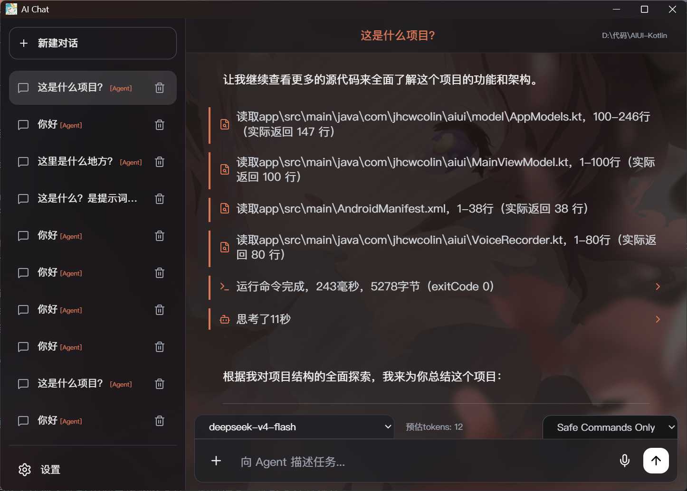
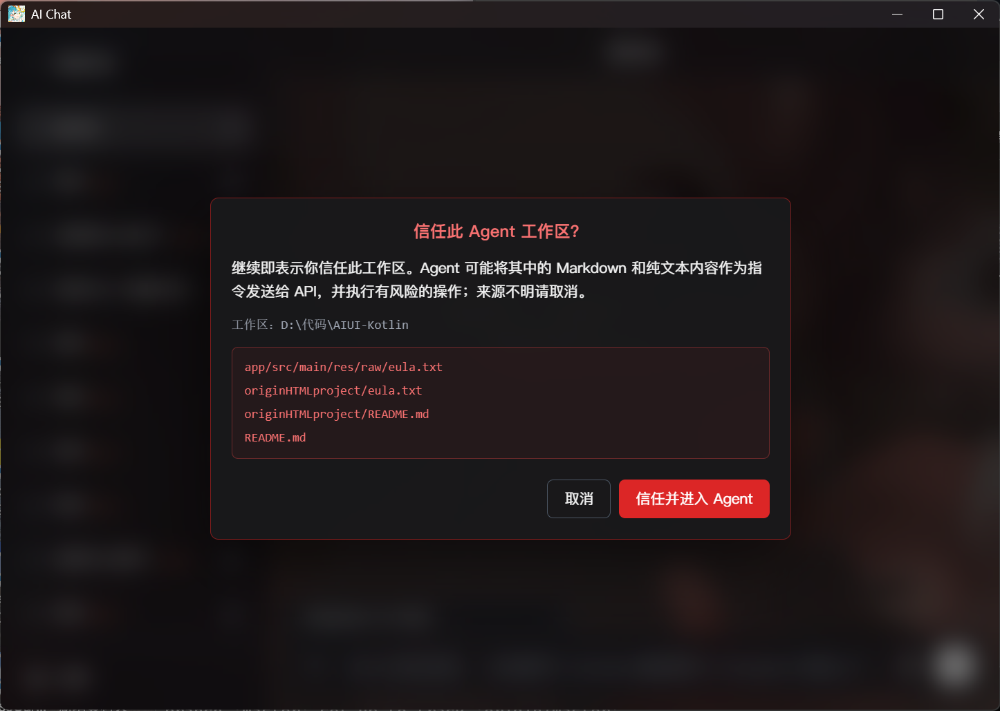
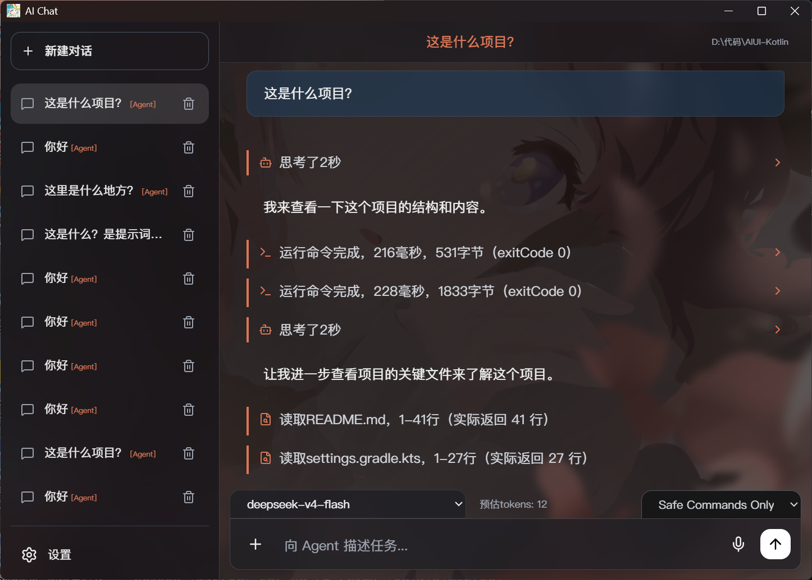
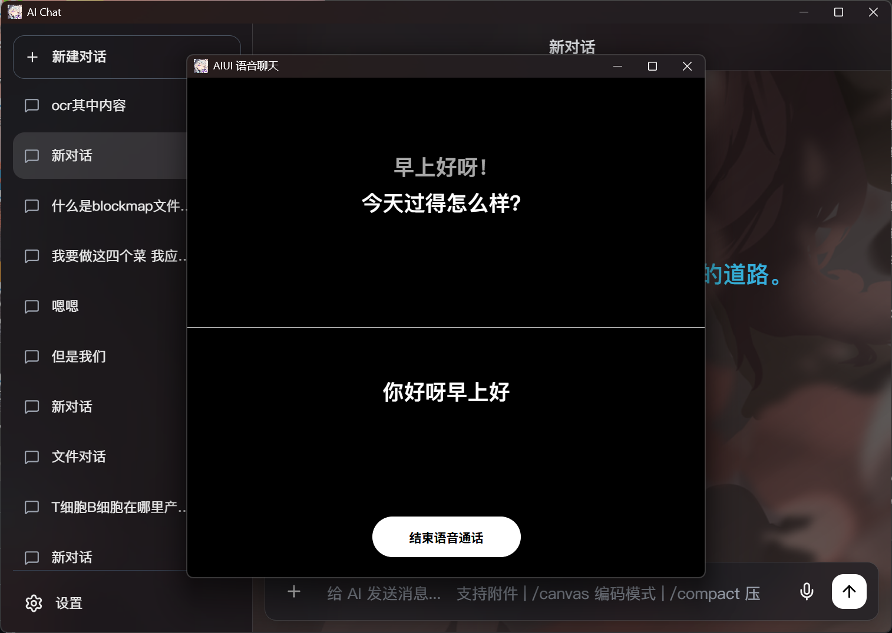
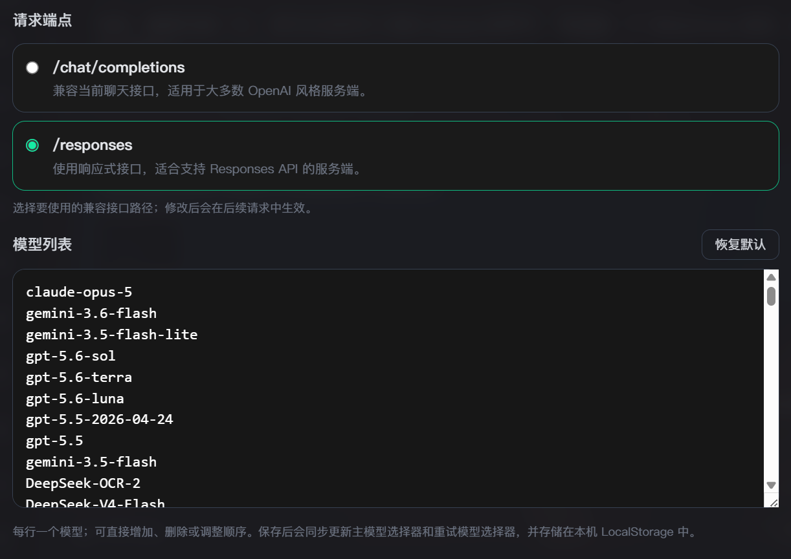

# Your Next Gen Vibe Coding Toolkit
# Free Yourself with AGENT

一个绑定了令牌后即可像大型AI官网那样Agent服务、文字畅聊、语音聊天、共享屏幕、修改代码的前端AI聊天框架。不依赖任何realtime模型，用http调用方法配合STT、TTS、VAD、预设语音等技术实现实时功能。

---

## 项目概览

AIUI 是一个以单页前端为核心、同时提供 Electron 桌面壳的 AI 工作台。当前版本重点覆盖以下能力：

- Agent工作流：让AI帮你直接修改文件、运行指令、读取文件等操作。
- 局域网 Agent 网关：在手机浏览器监看桌面当前 Agent 会话，并按授权追加任务消息。
- `/canvas` 编码模式：在对话旁直接生成和编辑代码画布。
- 桌面协作模式：透明置顶字幕、点击穿透、全局快捷键截图与语音上下文协作。
- 语音聊天模式：使用 Silero VAD、讯飞流式听写和 Fish Audio HTTP TTS。
- 多模型聊天：可配置 API Key、Base URL、模型列表和默认模型。
- 跨会话记忆：普通对话、Agent、语音聊天与桌面协作共用本机记忆，可在偏好设置中管理。
- 上下文用量：按模型选择本地 tokenizer 或估算方式，悬停查看消息、工具与系统提示等用量分解。
- 常驻系统托盘：支持新建或恢复最近会话，并可直接启动语音聊天或桌面协作。
- 语音回放：语音聊天模式生成的 AI 语音可保存并在主对话中回放。
- 附件解析：支持图片、`.docx`、`.pptx`、`.xlsx`、`.txt`、`.md` 等文件。
- 图像生成增强：支持在提示词中写入 `16:9`、`4:3`、`1:1` 等宽高比关键词。
- `/compact` 上下文压缩：支持自动摘要、手动和独立摘要模型。
- Agent Tool Calling：绑定工作区后，可通过标准 JSON 工具调用读取、写入、局部编辑文件并运行 Shell 命令。

---

## 最近更新

### V10.3.0 Release

- Agent 新增后端失败重试、正文实时流式显示，以及运行中插入消息的排队和打断选项。[完整更新日志](UPDATE.md#v1030-release--2026-11-27)

### V10.2.2 Release

- Agent 命令由独立进程管理，进度节流更新，长日志分页显示。[完整更新日志](UPDATE.md#v1022-release--2026-11-25)

### V10.2.1 Release

- 展开或折叠 Agent 历史活动、调整窗口大小时保留阅读位置。新消息、实时活动和返回底部按钮采用平滑滚动。
- 修复浅色主题下 Command Mode 警告、日志设置、Agent 网关控件及 Agent 活动详情的配色。[完整更新日志](UPDATE.md#v1021-release--2026-11-25)

### V10.2.0 Release

- 已保存语音回放和实时合成朗读在开始播放和切换句子时保留当前阅读位置。
- 终止实时合成朗读时，控制胶囊退出期间保持暂停与终止布局，避免闪现进度条。[完整更新日志](UPDATE.md#v1020-release--2026-11-22)

### V10.1.0 Release

- 普通对话的记忆工具兼容 DeepSeek DSML、OpenAI、Google Gemini 和 Anthropic 的调用格式。
- 文本回复支持分句朗读，普通对话和 Agent 可在语音聊天偏好中开启自动朗读。
- 更新消息播放按钮和播放胶囊，已保存的语音可以拖动进度，实时朗读提供暂停与终止控制。
- 修复 Android 签名构建遇到 Maven Central 限流时的依赖下载失败。[完整更新日志](UPDATE.md#v1010-release--2026-11-22)

### V10.0.0 Release

- 新增跨会话记忆，支持新增、修改、删除及操作数量提示。新会话读取最新记忆，已有会话的前缀可继续复用。
- 重构聊天布局、单行输入底栏、长消息折叠和消息操作，统一模型、Effort、审批、附件与归档菜单。
- 升级 Agent 思考、工具活动与运行计时，新增 Always Ask 命令模式和多级工具详情。
- Fish Audio 新增国内与国际端点，默认使用 S2.1 Pro (Free)。[完整更新日志](UPDATE.md#v1000-release--2026-11-22)

### V9.6.2 Release

- 默认模型列表刷新到各厂商最新：GPT-6.2 Astra / Sol、Claude Fable 5.2 / Mythos 5.2、Gemini 4 Neon / Hydrogen、Grok 4.7、Qwen4-Max、Kimi K3.1 Pro、Hy4 / Hy4 flash、豆包 2.1；默认模型改为 `gpt-6.2-sol`。
- 生图模型更新：GPT-Image-2.6 Sunburst / Flare、Nano Banana 2 系列、Seedream 5.5、MiniMax H3-Image。
- 偏好设置新增 **Gemini 原生（generateContent）** 与 **Ollama 原生（/api/chat）** 两种请求端点，支持各自的流式格式、图片输入与思考内容解析；语音与桌面协作窗口同步支持。
- 上下文容量规则同步新模型：GPT-6 400K，Qwen4 / Kimi K3 / Hy4 1M，Grok 4.7 500K。

### V9.6.1 Release

本次为纯目录结构整理，不包含功能改动，界面与行为与 V9.6.0 一致。

- 根目录仅保留配置、文档、脚本与 `src/`；60 余个源码与资源文件按职责迁入 `src/main`、`src/renderer`、`src/shared`、`src/vendor`、`src/assets`、`src/remote-control`、`src/test`。
- 入口页仍在 `src/` 根，`src/` 即 Web 根，本地调试、Electron 打包与移动端构建共用同一套相对路径。
- 配图与 logo 迁入 `docs/`，构建脚本迁入 `scripts/`，`.workbuddy-ai/` 不再进入安装包与版本库。
- 全部引用路径已同步更新，并通过单元测试、Electron 真实渲染与 Windows 打包验证。

### V9.6.0 Release

- 修复内置工具「浏览网页 / 搜索网页」只能访问 HTTPS、无法访问 HTTP 的问题。
- 联网超时调整为 1 分钟：无响应即中止并返回「Connection Reset」类错误，不再长时间挂起。
- Tokenizer 与上下文容量的规则拖拽排序改为平滑换位动画。

### V9.5.0 Release

**这是一次意义重大的更新**，围绕三大方向：自定性、稳定性与直观性。

**自定性 —— Tokenizer 与上下文容量**

- 偏好设置新增「Tokenizer」与「上下文容量」两个大类：每条规则在同一行里直接编辑模型名、词表或容量，修改即保存；支持正则匹配；未匹配的模型也作为一条可编辑的「默认」规则显示。
- 自定义词表只接受 HuggingFace 的 tokenizer.json，上传时先解析并实际编码一段文本，格式不对直接拒绝并提示原因。
- 内置 9 套本地词表：OpenAI（cl100k / o200k）、Anthropic Claude、DeepSeek V4 / V4.1，以及新增的 Qwen、GLM、Llama、Mistral、Yi、InternLM、Gemma 官方词表（Hugging Face 下载，本地精确计数）；Kimi 仅发布 tiktoken.model，Grok、Doubao、Hunyuan、Step、Gemini 无公开词表，继续使用通用估算并可指向自定义词表。
- 默认规则补齐文本模型厂商：grok、qwen、glm、kimi/moonshot、doubao、hunyuan、step，并给出各自的默认上下文容量。

**稳定性 —— 工具记录折叠**

- Agent 一轮任务结束后，这一轮的中间产物（思考了几秒、运行了什么指令等）自动折叠为一条汇总（运行 N 条指令 · 探索 N 个文件 · 编辑 N 处文件 · 联网 N 次），点开才懒加载展开；点进较长的历史 Agent 会话不再卡顿。
- Agent 系统提示词重写为全英文、去歧义、按 1 到 13 的正整数编号并精简去重；run_shell 的工具描述按用户操作系统探测后写入（Windows 为 PowerShell，其余为 Bash 登录 shell）。
- 各窗口补充最小宽高；修复 Context Breakdown 面板横向滚动条与长模型名折行。

**直观性 —— 界面大改款**

- 偏好设置所有分区统一为「副容器」卡片布局（除使用指导与关于外），相关设置项按组收纳，界面更清晰。
- Agent 模式右侧侧边栏新增「统计信息」面板：探索文件 / 运行指令 / 浏览网页 / 文件变更 / 代码变更行数，数字带滚动动画，按活动实时累计，并随会话与导入导出持久化。
- 语音聊天新增「语音合成时忽略括号内的文字」（默认开启）；语音会话不再单独设置模型。
- 分区标题统一为同一种字号与 Lucide 图标，去掉 Agent 页的内测提示。
- 应用、引导页与构建版本统一升级为 V9.5.0。

### V9.4.0 Release

- 移除独立偏好设置窗口打开时的淡入与缩放动画。
- 修复 API 配置档案读取结构不一致的问题，切换后立即恢复 API Key、Base URL、请求端点、模型列表、选中模型和最大 Token 限制。
- 配置管理改为「新建配置 → 创建配置」与「修改配置 → 保存修改」，名称和连接设置统一保存；支持放弃修改、重名校验与删除确认。
- 默认配置独立保留，切换或删除档案后可恢复；兼容旧版平铺档案格式。

### V9.3.0 Release

- 加号拓展菜单与 Context 详情统一磨砂通透度，改善背景下的可读性。
- 加号菜单与模型选择器互斥打开，同时关闭关联的推理深度子菜单。
- 偏好设置「关于」新增 AIUI NEXT V9 介绍，版本升级至 V9.3.0。

### V9.1.0 Release

- 提高背景通透度，去掉组件高光、发光阴影、悬停增亮和扫光。
- 恢复工具调用原来的居中宽度、左边界和缩进。
- 搜索摘要保持单行，超出显示省略号。

### V9.0.0 Release

- 全新模型与推理深度菜单、异步 Token 计数、Agent 用量与性能统计。
- Agent 信息侧栏、询问用户工具、增强工具解析及桌面系统通知。
- 独立偏好设置、可用模型发现、响应式输入框和统一主题布局。
- ZIP 会话导入导出、消息结束时间及三款新背景。
- 完整变更与计数限制请参阅 [更新日志](UPDATE.md)。

### V8.1.0 Release 局域网 Agent 网关

- 新增独立网关控制台和移动端远程页面，HTTP 轮询默认每秒同步。
- 支持网卡选择、端口、分级访问码、设备权限和一键踢线封禁。
- 远程设备仅访问桌面当前 Agent 会话，模型调用和工具执行全部留在桌面。

### V7.3.0 Release 增强中日韩解析能力

### V7.3.0 Release 修改Agent核心提示词

### V7.2.0 Release 修复缓存命中问题

### V7.1.0 Release 兼容Codex Claude Gemini的原生格式
- 当模型不遵循我们的工具调用规则，使用自家的agent工具的工具调用格式，我们也会支持。
- 全方位提升Agent体验，解决了大部分文本错位，正文被当作报错，连续产生空回复的问题。

### V7.0.0 Release Agent正式上线
- Agent 工作区选择后新增信任确认，自动扫描非依赖目录中的 `.txt` 与 `.md` 文件，并显示最多 5 个风险文件路径。
- Agent 首次触发自动上下文压缩前会询问用户，可直接改为不压缩、每 10、15 或 20 轮压缩，或保持当前设置。
- Agent 偏好设置新增内测与 API 分组兼容性警告，所有全屏 Agent 提示统一使用弹入弹出动画。
- Agent 固定提示词现在在会话创建时生成并持久化，包含稳定的会话开始时间。
- 删除每轮请求中插入的动态时间消息，避免第二次提问时改变已有前缀。
- 已存在的旧 Agent 会话会在下一次请求时补入该约束，之后保持不变。
- 普通聊天也会保存会话级 promptPrefix，后续只追加历史消息。
- 每个会话生成稳定的 prompt_cache_key，不同会话不会共用。
- /responses 端点现在保留 prompt_cache_key。

完整记录见 [UPDATE.md](UPDATE.md)。

---

## 核心功能

### Agent 局域网网关

1. 在 Electron 桌面端侧栏的「配置指引」上方点击「Agent 网关」，打开独立控制台；也可从系统托盘打开。
2. 选择监听 IP 和端口。默认优先使用物理网卡的 IPv4 地址，VPN、VMware 等虚拟接口排在后面；需要跨多个接口访问时可选择所有接口。
3. 开启网关，在同一局域网的手机或电脑浏览器中输入控制台显示的完整网址。Windows 防火墙需允许 Electron/AIUI 在所用网络接收入站连接。
4. 使用只读访问码监看，或先在控制台允许远程写入，再使用可写访问码。仅当前激活的 Agent 会话会被共享，切换会话后远程页面自动跟随。
5. 可写设备可以追加消息或继续下一轮任务；Agent 运行时消息进入原有队列，命令审批仍在桌面完成。远程页面不能选择历史会话、修改模型配置或直接调用工具。

控制台可热调轮询间隔（500–2000 毫秒）、会话有效期、设备上限及写入权限，亦可按设备降级、强制下线并封禁重连。更改监听地址或端口前需先关闭网关。关闭控制台窗口不会关闭服务，关闭网关或退出 AIUI 会使远程会话失效；每次启动应用均默认关闭网关。

远程页面同步当前会话的完整回复、全部工具调用及简略信息（例如运行指令第一行、文件路径、搜索关键词），并显示思考过程的开头与结尾几行。回复支持 Markdown 的代码块、表格、列表、链接与引用；页面支持亮暗主题，初次跟随系统，手动选择会被记住。

网关通过普通 HTTP 面向可信局域网提供服务，访问码及会话内容不经过加密传输；请勿将端口映射到公网。独立远程页面不保存模型凭据，网关不提供工作区文件下载、原始工具参数、命令输出或图片下载接口。

### 1. Agent 工作流

- 点击“+”进入Agent模式，绑定工作区后AI可以在此工作区内行动。
- AI通过五个基础工具来帮你操作本地文件，包括增查改删（CRUD）和运行指令，以及结束任务的工具。
- 处于Agent模式的会话不可退出。
- 用户可以选择指令运行的安全审查方式：仅安全指令和完全访问（YOLO Mode）。

### 2. Canvas 编码模式

- 在输入框发送 `/canvas` 后，右侧进入代码画布模式。
- 画布基于 CodeMirror，支持语法高亮、行号与手动编辑。
- AI 可通过 `[replace]` 风格的替换指令精确修改画布内容。

### 3. 语音聊天模式

- 独立 `audiochat.html` 页面，采用上下双分区字幕布局。
- 上半区显示 AI 字幕，下半区显示用户识别文本。
- AI 字幕支持按句自动跟随与逐句淡入。
- 语音聊天生成的 AI 语音可在主对话中按整次回复连续回放。
- 可在偏好设置中一键清除历史语音记录，不影响预制语音与后续新记录。
- 语音聊天可以从文字对话中途开始也可以之后转成文本继续对话。

### 4. 桌面协作模式

- 透明、无边框、始终置顶的横向字幕窗口默认停靠当前显示器底部。
- AI 与用户语音内容各占一行，白色字幕使用黑色文字阴影保证可读性。
- 除“结束对话”按钮区域外，窗口允许鼠标操作穿透到下层桌面。
- 全局传图快捷键默认是 `Ctrl+A`，截图精细度默认使用 1920px / JPEG 85。
- 多次截图只保留最后一张，并在下一次语音输入时作为用户消息附件发送。
- 可在偏好设置中开启自动传图；每轮语音结束后若没有手动截图，会自动截取鼠标所在显示器。
- 结束协作后，文字、AI 语音记录和截图会写回对应主会话。

### 5. 自动更新

- 仅 Windows Setup 安装版启用，Portable 版本和开发环境会跳过更新检查。
- “自动探测更新”默认开启，可在偏好设置“其他”中关闭。
- 启动时通过 GitHub Release 的 `latest.yml` 比较版本；发现更新后使用系统原生对话框询问用户。
- 下载阶段由 `electron-updater` 使用 Setup 对应的 `.blockmap` 自动执行差分更新。
- 每次 GitHub Release 必须同时上传 Setup 安装包、Setup `.blockmap` 和 `latest.yml`。

### 6. 多模型与 API 配置

- 支持自定义 Base URL、API Key、模型列表和默认模型。
- 模型配置保存在本地，适合长期个人环境使用。
- 主界面、语音聊天和桌面协作均支持 `/responses`、`/chat/completions`、`/v1/messages`、Gemini 原生与 Ollama 原生五种请求端点。
- `/responses` 返回 501 时会自动使用 `/chat/completions` 重试；Gemini 与 Ollama 原生协议不参与自动转接。
- Gemini 原生：Base URL 填 `https://generativelanguage.googleapis.com/v1beta`，密钥以 `x-goog-api-key` 发送。
- Ollama 原生：Base URL 填 `http://127.0.0.1:11434`，API Key 可留空，支持流式与图片输入。

### 7. 图像与附件工作流

- 支持图片粘贴、图片上传和常见 Office 文档解析。
- 图像请求支持提示词中的宽高比关键词。
- 附件内容会在提取后注入当前对话上下文。

### 8. 上下文压缩

- 可在长对话中自动或手动压缩上下文。
- 摘要用于降低发送给模型的上下文长度，不覆盖原始聊天记录。

---

## 运行方式

npm install
npm start
npm run build  //构建

构建输出目录：`dist/`

测试：`npm test` 运行全部单元与接口回归；`npm run test:gateway-ui` 使用真实 Electron 窗口验证网关认证、监看、桌面消息队列、设备降权与强制下线（模型响应使用本地模拟）。

真实模型回归需显式设置环境变量 `AIUI_AGENT_LIVE_TEST=1`，再执行 `npm run test:agent-live`。此测试使用当前 Windows 用户 AIUI 的 API 连接配置和 `deepseek-flash`，会消耗 API 用量；仅在新建的临时工作区执行文件与进程操作，退出后清理临时配置与工作区，保留不含连接凭据的测试报告。

### Android / iOS 构建

推送 `V*` 标签触发 `.github/workflows/electron-build.yaml`，同时产出桌面端与移动端安装包；也可在 Actions 页面手动触发（`workflow_dispatch`），该模式只构建、不发布 Release。

Android APK 使用仓库内的 `android-release.p12` 签名（alias `aiui`，口令 `12345678`，有效期至 2056）。该证书为公开分发用途，不含任何第三方敏感信息；构建结束后由 `apksigner verify` 断言签名有效，再上传 Release。

---

## 版本信息

- 当前版本：`V10.3.0 Release`
- 当前构建标识：`build20261119`

---

## License

本项目基于 [MIT License](LICENSE) 发布。
